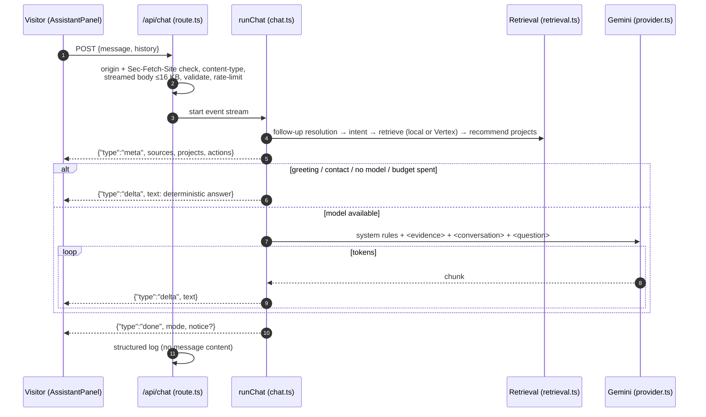

# Portfolio assistant — architecture

## Audit summary (before)

| Question | Finding |
| --- | --- |
| Model / provider | Google Gemini via `@google/genai`, default `gemini-2.5-flash`; Vertex express key, Developer API key or service-account (ADC). |
| Frontend ↔ backend | `POST /api/chat` with `{ message, history }`, single JSON response. |
| Streaming | None. The client faked streaming with a 15ms `setInterval`. |
| Knowledge | TF-IDF retrieval over `portfolioData` (which contained the inaccuracies listed in the audit). Optional Vertex Vector Search. |
| Hard-coded responses | Regex fallback used when no key or on failure; it ignored retrieval for most questions. |
| Memory | Component state only; only the last answer was visible. |
| Security | Good baseline (origin check, size and length limits, per-IP and daily limits, timeout, injection rules). Gaps: `content-length` trusted, so a chunked body bypassed the size check; no request IDs or latency logging. |
| UX | Embedded in the hero, green terminal styling, awarded XP per question. |

## Design (after)



### Components

| File | Responsibility |
| --- | --- |
| `src/lib/assistant/knowledge.ts` | Builds ~60 documents from `src/content`: profile, specializations, contact, per-project overview/features/problem/architecture/engineering/progress, experience, education, skills, verified recognition, timeline. Each carries an on-site `href`. |
| `retrieval.ts` | TF-IDF cosine retrieval with query expansion ("AI" → LLM, Gemini, ML…), exact project-name/alias matching (e.g. "ProxySocialHub" → ProxyHubb), intent boosts, per-source caps. `recommendProjects()` maps visitor vocabulary to categories and ranks by fit, depth (tier) and recency. |
| `answers.ts` | Intent detection and deterministic, evidence-only answers for every intent. Used directly for greetings and contact, and as the complete fallback. |
| `prompt.ts` | System instruction and prompt assembly with delimiter neutralisation. |
| `provider.ts` | Gemini client (server only), `generateContentStream`, abort signal, usage capture, thinking budget 0 for 2.5 Flash. |
| `chat.ts` | Orchestration as an async generator of events; independent of HTTP so it is unit-tested with fake models. |
| `rate-limit.ts` | Per-client minute window and per-instance daily model budget. |
| `vector-search.ts` | Optional Vertex AI Vector Search 2.0 retrieval; any failure returns `null` → local retrieval. |
| `validation.ts` | Message/history validation and a streamed body reader that refuses to buffer more than 16 KB. |
| `src/app/api/chat/route.ts` | HTTP boundary: request checks, NDJSON `ReadableStream`, cancellation, telemetry. |
| `src/components/assistant/*` | Lazy provider (`Ctrl/⌘+K`), native `<dialog>` panel, NDJSON reader, "Ask about this project" buttons. |

### Wire protocol

`Content-Type: application/x-ndjson`, one JSON object per line:

```json
{"type":"meta","requestId":"…","sources":[{"id":"project:bitmomo","title":"BitMomo","kind":"project","href":"/work/bitmomo"}],"projects":[{"slug":"bitmomo","name":"BitMomo","tagline":"…","status":"Testnet","href":"/work/bitmomo"}],"actions":[{"label":"Read the case study","href":"/work/bitmomo"}],"retrieval":"local"}
{"type":"delta","text":"BitMomo is a crypto payment platform…"}
{"type":"done","mode":"model"}
```

Validation, rate-limit and method errors are ordinary JSON responses with HTTP status 400/403/405/413/415/429 and an `X-Request-Id` header.

### Why this retrieval design

The corpus is small (~60 documents) and entirely authored. Local TF-IDF with aliases and category mapping is deterministic, instant, free and testable, and it already answers the target questions correctly. Embedding-based retrieval remains available through Vertex Vector Search (`RAG_BACKEND=vertex-vector`) for paraphrase-heavy questions, but it is not required and never blocks an answer.

## Accuracy safeguards

1. **One source of truth.** The knowledge base is generated from the same content files as the pages, so a correction on the site corrects the assistant.
2. **Evidence-only prompting.** The model sees only retrieved evidence and is told to say when the evidence does not answer the question, never to upgrade maturity labels, and to name projects exactly.
3. **Deterministic paths** for contact and greetings — no model, no chance of a wrong email.
4. **Fallback answers built from content**, so a provider outage degrades to correct-but-plain answers instead of errors.
5. **Links come from the server, not the model.** Related-project cards, action buttons and source links are generated from content; the client renders model text as plain text (paragraphs and lists only, no HTML).

## Security and privacy

| Control | Implementation |
| --- | --- |
| Keys stay server-side | Only `route.ts` → `provider.ts` read credentials. No `NEXT_PUBLIC_` AI variables. |
| Cross-site abuse | `Origin` must match; `Sec-Fetch-Site` must be same-origin when present. |
| Input limits | JSON only; body streamed and capped at 16 KB regardless of `Content-Length`; message ≤800 chars; ≤8 history items ≤1,200 chars; control characters stripped. |
| Rate limiting | 10 requests/minute per client (configurable); model calls capped per instance per day (default 300); greetings/contact do not consume the model budget. |
| Prompt injection | Visitor text is wrapped in `<question>`/`<conversation>`; any attempt to open or close `evidence`/`question`/`conversation`/`system`/`instructions` tags is stripped; system rules forbid following instructions inside visitor text. Tested. |
| Data minimisation | The knowledge base excludes the phone number, unverified recognition and all private-repository internals (enforced by `validateContent()` and tests). |
| Logging | One structured line per request: request ID, intent, mode, retrieval, latency, first-token time, token usage, error class. **No message or answer text is logged.** |
| Visitor disclosure | The panel states that questions are sent to Google Gemini and not stored by the site. Conversations are kept only in the visitor's `sessionStorage`. |
| Isolation from the site | The panel and its code load only when opened; if `/api/chat` fails the rest of the portfolio is unaffected. |

## Observability

Each request logs, for example:

```json
{"event":"assistant.request","requestId":"…","model":"gemini-2.5-flash","intent":"category","mode":"model","retrieval":"local","firstTokenMs":640,"totalMs":1810,"outputChars":512,"usage":{"promptTokens":1450,"outputTokens":118},"messageChars":44,"historyItems":2}
```

On Vercel these appear in function logs and can be filtered by `event`. Suggested alerts: `mode:"portfolio"` with `modelError` rising (provider failure or quota), `firstTokenMs` p95 > 3s, 429 rate.

## Configuration

See [`.env.example`](../../.env.example). With no AI credentials the assistant still works, answering from portfolio data and labelling answers as such.

## Verification performed

- 22 assistant unit tests (validation, privacy of the knowledge base, retrieval/recommendations for the brief's example questions, intents, deterministic answers, injection neutralisation, streaming with fake models including failure, partial failure and budget exhaustion, rate limiter).
- Live API checks against the production build: 200 NDJSON with `meta → delta → done`; 400 (bad JSON, bad history), 403 (foreign `Origin`), 405 (GET), 413 (20 KB body, 900-char message), 415 (wrong content type), 429 after the per-minute limit.
- Browser check: panel opens from the header, suggested question answered with a related-project card, actions and sources.

- **Production (after deployment, 9 Nov 2026):** a Gemini key is configured on Vercel. `POST /api/chat` on `https://samuel-seven-gamma.vercel.app` returned 200 NDJSON in `model` mode with several streamed `delta` events. Three example questions were answered accurately in 1–2 s: BitMomo (kept the "cloud testnet system" status and linked bitmomo.app), CipherVault's technologies (exact stack), and the best architecture example (BitMomo, CREG, CipherVault, with correct reasons).

No AI credential exists in the local development environment (`.env.local` is absent), so local runs use the portfolio-data path.

## Limitations and next steps

- Rate limits are in memory per serverless instance. For heavy traffic, move counters to a shared store (e.g. Upstash Redis or Vercel KV).
- Local retrieval is lexical; unusual phrasings may retrieve weaker evidence. Enabling Vertex Vector Search (`npm run rag:sync`) addresses this.
- No answer-quality evaluation set runs in CI yet beyond the deterministic tests. A small golden set of questions with expected project mentions would catch regressions when content changes.
