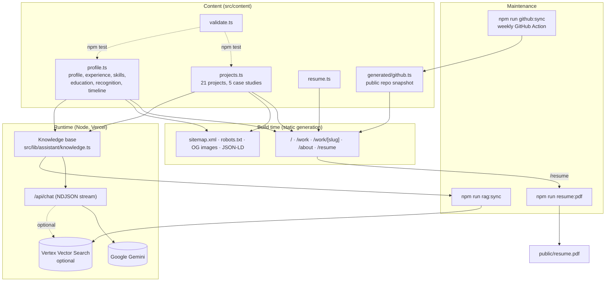

# Portfolio architecture

## Decision: keep the stack

The existing stack — Next.js 16 (App Router), React 19, TypeScript, Tailwind CSS 4, deployed on Vercel — was retained. Nothing in the audit required a framework migration: the problems were a fully client-rendered single page, duplicated data, dead code and inaccurate content, all of which are fixed inside the current stack. One dependency was added (`geist`, self-hosted fonts); none were added for animation, state management, diagrams or Markdown.

## System overview



## Routes

| Route | Rendering | Purpose |
| --- | --- | --- |
| `/` | Static | Hero, case-study list, "at a glance" recruiter band, more work, recent milestones |
| `/work` | Static + client filter island | Case studies plus a filterable, searchable index of all projects (`?category=` is shareable) |
| `/work/[slug]` | SSG for all 21 projects (`dynamicParams = false`) | Case study (problem, approach, architecture diagram, request flow, features, decisions, challenges, status) or a short project page |
| `/work/[slug]/opengraph-image` | SSG | Per-project black-and-white social card |
| `/about` | Static | Story, experience, skills, education, recognition, timeline |
| `/resume` | Static | ATS-friendly HTML résumé; printable; source of `public/resume.pdf` |
| `/api/chat` | Dynamic (Node) | Portfolio assistant |
| `/sitemap.xml`, `/robots.txt`, `/opengraph-image`, `/icon.svg` | Static | SEO and sharing |

Contact is the inverted footer band (`#contact`) present on every page rather than a separate page.

## Folder structure

```text
src/
  app/                      routes, metadata, OG images, global CSS
    api/chat/route.ts       HTTP boundary for the assistant
  components/
    site/                   header, footer, theme toggle, nav config
    ui/primitives.tsx       buttons, tags, headings, status, icons
    work/                   project rows, explorer, architecture diagram
    assistant/              provider (lazy), panel, protocol, ask button
    resume/                 print button
    og/                     social card layout
  content/                  typed content model — the single source of truth
    types.ts  projects.ts  profile.ts  resume.ts  index.ts  validate.ts
    generated/github.ts     machine-written snapshot (do not edit)
  lib/assistant/            framework-free assistant logic (unit-tested with node:test)
scripts/                    github sync, résumé PDF, vector search sync/verify
docs/portfolio-modernization/
```

Boundaries:

- **Content** has no React or Next imports, so the same files feed pages, the résumé, tests and the assistant.
- **`lib/assistant`** has no Next imports (except via `route.ts`), so retrieval, answers, prompts and orchestration run in plain Node tests.
- **Client components** are small islands: header (active route, mobile menu), theme toggle, project explorer, ask buttons, and the assistant provider. The assistant panel itself is loaded with `next/dynamic` only when first opened.

## Content model

Defined in [`src/content/types.ts`](../../src/content/types.ts). Key rules:

- Each `Project` has a `tier` (`featured` / `standard` / `archive`), a `status` from a fixed vocabulary plus an evidence-backed `statusNote`, a `role`, dates, `stack`, `highlights`, typed `links` and an optional `caseStudy`.
- `repository.visibility` decides whether a source link may exist; private repositories never get one.
- `validateContent()` enforces slugs, dates, https links, featured ⇒ case study, archive ⇒ archived status, résumé references, verified recognition ⇒ evidence link, and **scans all public content for forbidden internal identifiers** (cloud project IDs, IPs, internal dev hostnames). It runs in `npm test` and CI.

## GitHub-backed metadata

- `npm run github:sync` queries the GitHub REST API for **public** repositories only and writes `src/content/generated/github.ts` (pushed date, stars, language, licence, archived flag).
- The site never calls GitHub at request time. A GitHub outage cannot affect it.
- `getLastActivity()` uses the newer of the content file's `lastActivity` and the snapshot.
- `.github/workflows/github-sync.yml` runs weekly and opens a pull request only when the snapshot changes, so updates are reviewable and only touch one generated file.
- If a repository turns private, the script refuses to record it and exits non-zero (this happened during the audit for `ProxySocialHub`).

## SEO

- `metadataBase` from `NEXT_PUBLIC_SITE_URL` (default `https://samuel-seven-gamma.vercel.app`), canonical URL per page, page-specific titles and descriptions.
- Open Graph / Twitter cards with generated 1200×630 monochrome images (site-wide and per project).
- JSON-LD: `Person` and `WebSite` in the layout; `SoftwareSourceCode` (public repos) or `CreativeWork` (private) per project, with only fields that are true.
- `sitemap.xml` lists real routes with last-modified dates from project activity; `robots.txt` disallows `/api/`.

## Security headers

`next.config.ts` sets a CSP (`default-src 'self'`, no third-party origins, `frame-ancestors 'none'`, `object-src 'none'`), `X-Frame-Options: DENY`, `X-Content-Type-Options`, `Referrer-Policy`, `Cross-Origin-Opener-Policy`, HSTS and a restrictive `Permissions-Policy`. `'unsafe-inline'` remains for scripts because Next.js inlines its bootstrap and the site uses an inline pre-paint theme script and JSON-LD; moving to nonces would force dynamic rendering of every page.

## Deployment

Unchanged: Vercel (or any Node host). Required environment: none. Optional: `NEXT_PUBLIC_SITE_URL`, Gemini credentials, rate-limit settings, Vector Search settings — see [`.env.example`](../../.env.example).

CI (`.github/workflows/ci.yml`) runs lint, typecheck, unit tests and the production build on every push and pull request. The build uses webpack (`next build --webpack`) because of an earlier Turbopack panic recorded in the July audit.

## Testing

| Suite | File | Covers |
| --- | --- | --- |
| Content | `src/content/content.test.ts` | Validation, featured set, private-link rule, unverified recognition, résumé references, formatting helpers |
| Assistant | `src/lib/assistant/assistant.test.ts` | Input validation and body limit, knowledge-base privacy, retrieval and recommendations, intent detection, deterministic answers, prompt-injection delimiters, streaming orchestration (no model, model, failure, partial failure, budget), rate limiter |

34 tests, run with Node's built-in runner and `--experimental-strip-types` (no test framework dependency).
